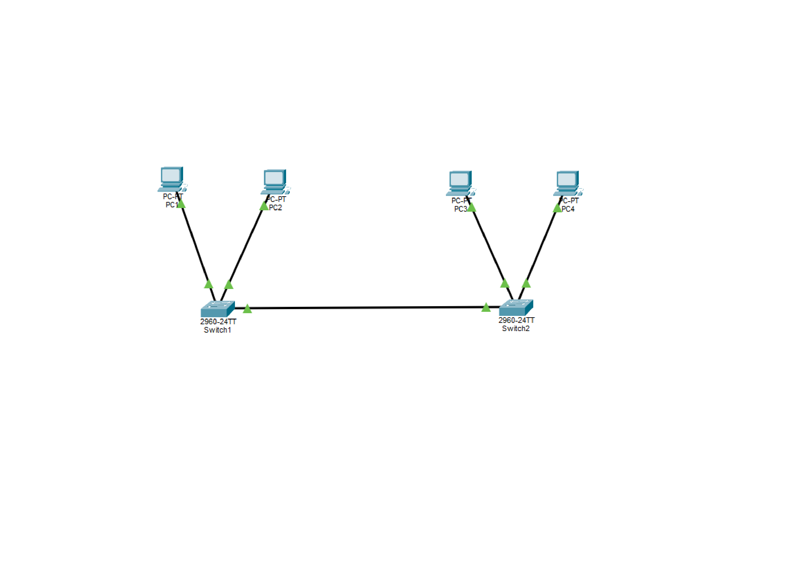

# Laboratório 04 — Trunking e IEEE 802.1Q

## Objetivo
Configurar duas VLANs em dois switches Cisco 2960, utilizando um enlace Trunk IEEE 802.1Q para permitir a comunicação entre computadores da mesma VLAN conectados a switches diferentes.

## Ferramentas e equipamentos
- Cisco Packet Tracer
- 2 switches Cisco 2960
- 4 computadores
- Cabos Ethernet

## Topologia

- SW-01 Gi0/1 conectado ao SW-02 Gi0/1 (Trunk)
- PC-01 conectado ao SW-01 Fa0/1 (VLAN 10)
- PC-02 conectado ao SW-01 Fa0/2 (VLAN 20)
- PC-03 conectado ao SW-02 Fa0/1 (VLAN 10)
- PC-04 conectado ao SW-02 Fa0/2 (VLAN 20)

## Endereçamento IP
| Computador | VLAN | Endereço IP | Máscara |
|---|---|---|---|
| PC-01 | 10 | 192.168.10.10 | 255.255.255.0 |
| PC-02 | 20 | 192.168.20.10 | 255.255.255.0 |
| PC-03 | 10 | 192.168.10.20 | 255.255.255.0 |
| PC-04 | 20 | 192.168.20.20 | 255.255.255.0 |

## Configuração do SW-01
```text
enable
configure terminal
hostname SW-01
vlan 10
name ADMINISTRACAO
exit
vlan 20
name FINANCEIRO
exit
interface fastEthernet 0/1
switchport mode access
switchport access vlan 10
exit
interface fastEthernet 0/2
switchport mode access
switchport access vlan 20
exit
interface gigabitEthernet 0/1
switchport mode trunk
switchport trunk allowed vlan 10,20
no shutdown
end
copy running-config startup-config
```

## Configuração do SW-02
```text
enable
configure terminal
hostname SW-02
vlan 10
name ADMINISTRACAO
exit
vlan 20
name FINANCEIRO
exit
interface fastEthernet 0/1
switchport mode access
switchport access vlan 10
exit
interface fastEthernet 0/2
switchport mode access
switchport access vlan 20
exit
interface gigabitEthernet 0/1
switchport mode trunk
switchport trunk allowed vlan 10,20
no shutdown
end
copy running-config startup-config
```

## Verificação
Comandos utilizados:
```text
show vlan brief
show interfaces trunk
```

## Testes de conectividade
| Origem | Destino | Resultado esperado |
|---|---|---|
| PC-01 | PC-03 | Sucesso — VLAN 10 |
| PC-02 | PC-04 | Sucesso — VLAN 20 |
| PC-01 | PC-04 | Sem comunicação — VLANs diferentes |

## Resultado
O laboratório foi concluído e a topologia funcionou conforme o esperado. O enlace Trunk permitiu transportar as VLANs 10 e 20 entre os dois switches. Não foi configurado roteamento entre VLANs.

## Conhecimentos praticados
- Criação e identificação de VLANs
- Configuração de portas Access
- Configuração de portas Trunk
- Protocolo IEEE 802.1Q
- Verificação e testes de conectividade

**Projeto de estudos para a certificação Cisco CCNA 200-301.**
